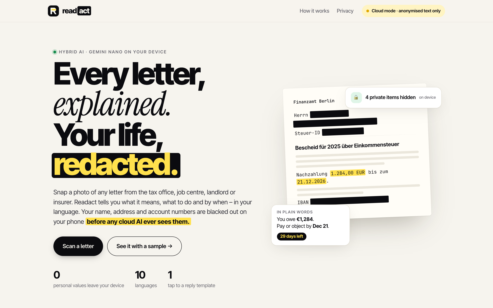
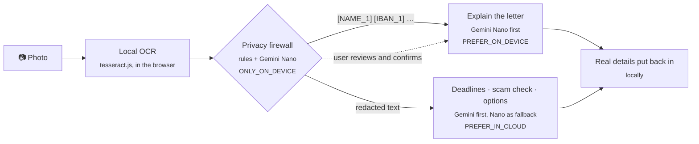
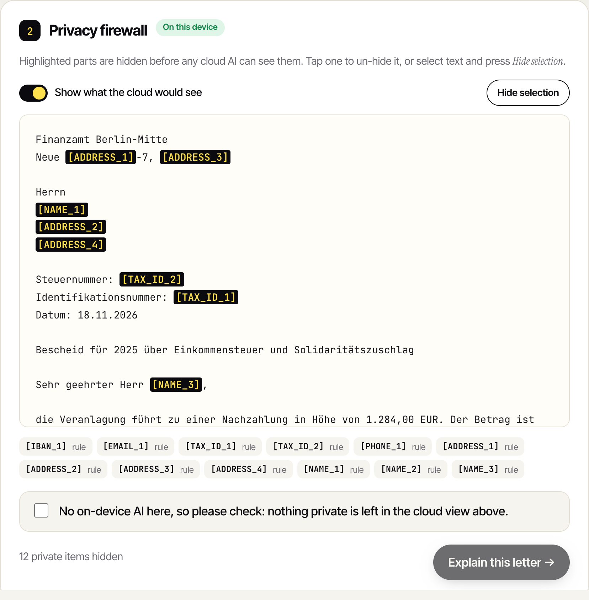
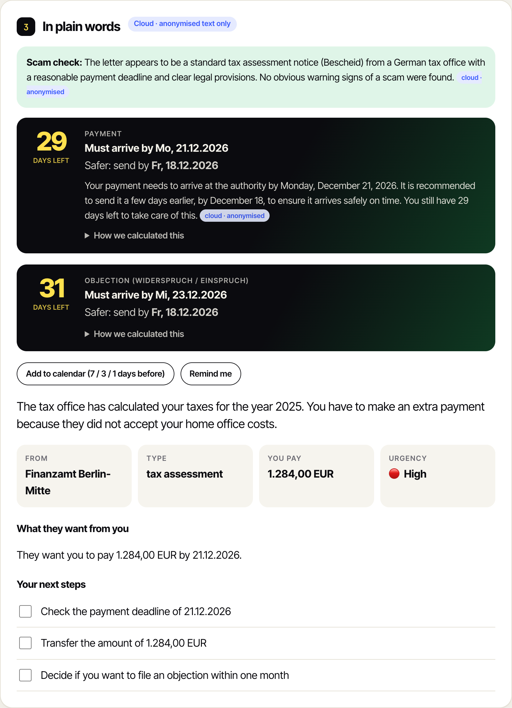
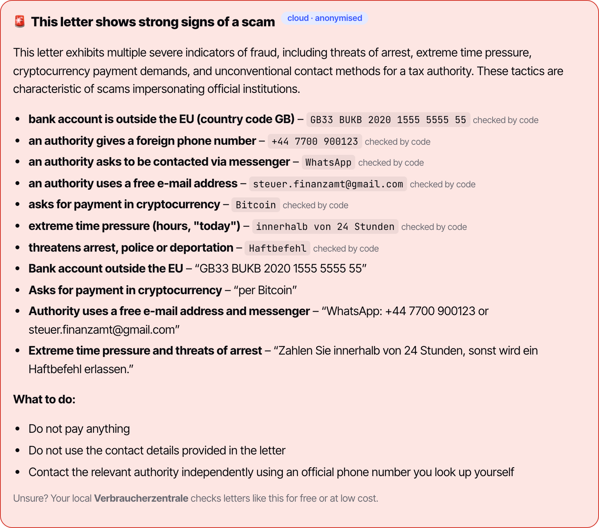
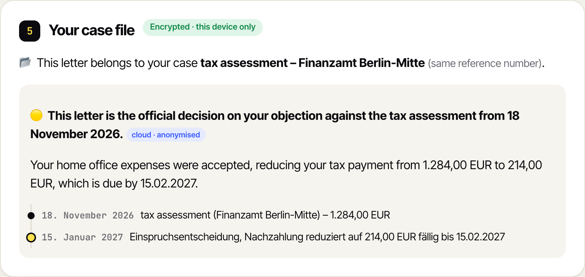
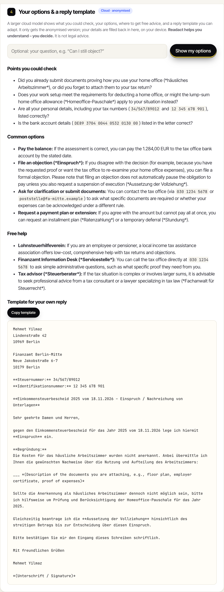
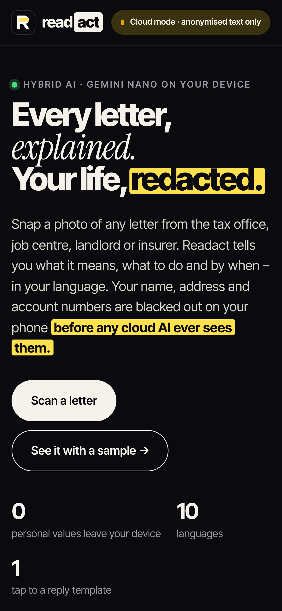

<div align="center">


# Readact

**Every letter, explained. Your life, redacted.**

Snap a photo of an official letter. Readact tells you what it means, what to do and by when, in your language.<br/>
Your name, address and account numbers are blacked out **on your device** before any cloud AI sees the text.

[](https://readact-app.web.app)
[](coming-soon!)


<sub>Built for <b>#BuildHybridAI 2026</b> (Google · Firebase · Devpost) · Web / Chrome category</sub>

<br/>



</div>

---

## The problem

Millions of people in Germany get letters they can't fully understand: tax assessments, job centre decisions, health insurance rejections, debt collection, rent increases. Deadlines get missed, money is lost, objections are never filed.

The common fix today is to photograph the letter and paste it into a chatbot. That sends the most sensitive data a person has (full name, home address, IBAN, tax ID, sometimes a diagnosis) to a server, just to understand one paragraph.

## The idea

Most hybrid AI apps use the on-device model as a **fallback** for when there's no network. Readact uses it as a **gatekeeper**: the local model sits _in front of_ the cloud and decides what the cloud is allowed to see.



The cloud only ever sees `Herrn [NAME_1], [ADDRESS_1], IBAN [IBAN_1]`. Answers come back with the same placeholders, and Readact fills in the real values on the device.

## What it does

<table>
<tr>
<td width="50%" valign="top">

### 🔒 Privacy firewall

Rules catch IBANs, tax and insurance IDs, phone numbers, e-mails, addresses, names (also _Ayşe_, _Kovalenko_, _Nguyen_), family members, birth dates and diagnoses. Gemini Nano finds what the rules miss. The user sees exactly what would be sent and has to confirm. A final guard in code blocks any request that still contains a known private value.

</td>
<td width="50%"></td>
</tr>
<tr>
<td valign="top">

### ⏰ Deadlines that are actually right

The model only _extracts_ what the letter says ("innerhalb eines Monats nach Bekanntgabe"). Code does the maths: 4-day postal rule (new since 2025), §§ 187–193 BGB, weekends and the public holidays of the user's federal state. Every date comes with "how we calculated this", a safer send-by date and a calendar file with reminders.

</td>
<td></td>
</tr>
<tr>
<td valign="top">

### 🚨 Scam check

Fake tax offices and debt collectors are a real problem. Hard rules run first: IBAN checksum, non-EU accounts, premium or foreign phone numbers, WhatsApp and Gmail contacts, look-alike domains, crypto and gift cards, threats and time pressure. Then Gemini looks at the wording. The model can raise the risk level, never lower it.

</td>
<td></td>
</tr>
<tr>
<td valign="top">

### 📂 Case memory

Letters about the same matter are linked automatically, by reference number or by "Ihr Schreiben vom …". The next letter is explained in context: _"This is the decision on your objection. The payment drops to €214."_ Stored only on the device, encrypted with AES-GCM and a non-extractable WebCrypto key.

</td>
<td></td>
</tr>
<tr>
<td valign="top">

### ✍️ Options and a reply template

For harder cases a larger cloud model lists what to double-check, the common options, free advice services (Verbraucherzentrale, Lohnsteuerhilfeverein, Mieterverein …) and a reply template in German that the user adapts and sends themselves.

</td>
<td></td>
</tr>
</table>

Plus: 10 answer languages, works offline with Gemini Nano, light and dark mode, and it runs fine on a cheap phone because the privacy layer doesn't depend on on-device AI.

<p align="center"></p>

## How Firebase AI Logic is used

Every model call goes through the Firebase AI Logic Web SDK ([`src/ai.ts`](src/ai.ts)). Readact uses **all four inference modes**, picked per step by what that step is allowed to see and by speed: Gemini Nano handles one request at a time, so it does the privacy work and the main explanation, while the heavier redacted steps run in the cloud in parallel and fall back to Nano when the cloud is unreachable.

| Step                                      | Mode               | Why                                                                                           |
| ----------------------------------------- | ------------------ | --------------------------------------------------------------------------------------------- |
| Find personal data the rules missed       | `ONLY_ON_DEVICE`   | sees the letter before redaction is complete, must never leave the device                     |
| Second privacy pass before any cloud call | `ONLY_ON_DEVICE`   | independent check right before sending                                                        |
| Explain the letter                        | `PREFER_ON_DEVICE` | fast and offline with Nano, cloud fallback gets redacted text only                            |
| Extract deadlines                         | `PREFER_IN_CLOUD`  | extraction only, no date maths; runs in parallel while Nano explains                          |
| Scam wording check                        | `PREFER_IN_CLOUD`  | gets the rule findings from code as input                                                     |
| Explain a deadline in calm words          | `PREFER_IN_CLOUD`  | no personal data at all                                                                       |
| Put a new letter in context of a case     | `PREFER_IN_CLOUD`  | history is redacted with all secrets of the case                                              |
| Options + reply template                  | `PREFER_IN_CLOUD`  | bigger cloud model; Gemini Nano takes over if the cloud is unreachable or rejects the request |

Structured output uses `responseConstraint` on device and `responseJsonSchema` in the cloud, with the same JSON schema. The UI shows for every result whether it was computed **on device** or **in the cloud (anonymised)**.

Other Firebase products:

- **App Check** with reCAPTCHA Enterprise (debug token for local development)
- **Remote Config** for the cloud model names
- **Authentication**, anonymous, so nobody needs an account
- **Firestore** in the EU (`eur3`) for deadline reminders, locked down by [`firestore.rules`](firestore.rules) and storing only a title, a date and a task
- **Hosting**

## Tech stack

TypeScript (strict) · Vite · Firebase JS SDK 13 (`firebase/ai`) · Chrome built-in AI (Gemini Nano) · tesseract.js · WebCrypto · IndexedDB · plain CSS (no UI framework) · Playwright (screenshots)

## Run it locally

```bash
npm install
cp .env.example .env        # add your Firebase web config, see below
npm run dev                 # http://localhost:5173
```

```bash
npm test                    # privacy, deadline and scam-check suites
npm run lint                # type check + formatting
```

<details>
<summary><b>Firebase setup</b></summary>

1. Create a Firebase project and add a **Web app**. Put its config into `.env`.
2. **AI Logic** → Get started → **Gemini Developer API**.
3. **App Check**: create a reCAPTCHA (Fraud Defense) website key for `localhost` and your hosting domain, register the web app with it, and put the key into `VITE_RECAPTCHA_ENTERPRISE_KEY`. For local development add a debug token under _App Check → Manage debug tokens_ and set it as `VITE_APPCHECK_DEBUG_TOKEN`.
4. **Authentication** → enable **Anonymous**.
5. Create Firestore in the EU and deploy rules and Remote Config:
   ```bash
   npx firebase-tools firestore:databases:create "(default)" --location eur3
   npx firebase-tools deploy --only firestore:rules,remoteconfig
   ```
6. Deploy: `npm run build && npx firebase-tools deploy --only hosting`

</details>

<details>
<summary><b>Turning on Gemini Nano in Chrome</b></summary>

Desktop Chrome with enough memory and disk space. Open `chrome://flags/#prompt-api`, set it to **Enabled Multilingual** and restart. Check the model status at `chrome://on-device-internals`. Then click **Download** in the status chip of the app. Without Nano everything still works; the cloud steps simply get the redacted text.

</details>

## Project structure

```
src/
  ai.ts           every Firebase AI Logic call and prompt
  pii.ts          privacy firewall: detection rules, placeholders, restore, leak check
  deadline.ts     deadline maths with German public holidays (no AI)
  fraud.ts        scam-check rules (IBAN checksum, domains, payment methods …)
  cases.ts        encrypted on-device case memory and letter matching
  ocr.ts          OCR in a Web Worker
  reminders.ts    Firestore reminders and .ics export
  firebase.ts     app, App Check, Remote Config, Auth, Firestore
  main.ts         UI
  *.test.ts       tests, run with npm test
scripts/
  screenshots.mjs regenerates the images in docs/screenshots
```

## Testing

`npm test` runs three suites against five realistic (fictional) letters from a tax office, a job centre, a health insurer, a debt collector and a landlord:

- **Privacy:** 47 / 47 private values caught by the rules alone, nothing important over-redacted, `restore()` is lossless, placeholders echoed by a model never block the request.
- **Deadlines:** 14 cases, including Easter Monday, Reformationstag in Lower Saxony vs. Bavaria, 31 January + 1 month, and the yellow envelope.
- **Scam check:** no false alarms on the real letters, every red flag found in a fake one.

## About the hackathon

Readact was built for **[#BuildHybridAI 2026](https://firebasehybridaihackathon.devpost.com/)** in November 2026, during the submission period. It is a new project; no code existed before.

- **Platform:** Web (Chrome) with Gemini Nano via Firebase AI Logic
- **Built with:** Claude Code as AI coding assistant. Product idea, design decisions, testing and the final say on every feature: me.
- **Open source used:** Firebase JS SDK (Apache-2.0), tesseract.js (Apache-2.0), Vite (MIT), Playwright (Apache-2.0), Inter Tight / Instrument Serif / JetBrains Mono (SIL OFL)
- **Test data:** all letters, names, numbers and addresses in this repo are made up.

### What I'd build next

- Android app with Gemini Nano through the same SDK, so the camera flow feels native
- Letter templates checked by legal advice services
- A family mode: help a parent with their letters without seeing their data

## Disclaimer

Readact helps people understand letters and prepare their own reply. It does not decide whether a decision is lawful and is not legal advice; it points to free professional advice services. Before a public launch in Germany the setup should be reviewed against the Legal Services Act (RDG), and the deadline rules by a lawyer.

## License

[Apache 2.0](LICENSE)

<div align="center">
<sub>Made with Firebase AI Logic and Gemini · <a href="https://devpost.com/ahmetdogn">Devpost</a></sub>
</div>
